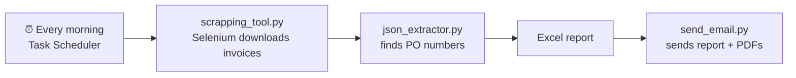

<p align="center">
  
</p>

<p align="center">
  
</p>

<p align="center">
  
  
  
  
</p>

## What is this?

An accounting team had to open the **Egyptian e-invoice portal** ([invoicing.eta.gov.eg](https://invoicing.eta.gov.eg/)) every day and copy invoice data by hand.

This project does all of it **automatically**:

1. Logs in to the portal and downloads yesterday's invoices (JSON + PDF).
2. Reads each invoice and finds the **PO number**, the supplier and the main fields.
3. Puts everything in an **Excel report**.
4. **Emails** the report and the PDFs to the team.

## How it works



## Main features

- **Smart PO search**: looks for the PO number in many fields, with rules and regex. It also reads Arabic numbers (٠١٢٣).
- **Clean data**: skips cancelled and rejected invoices, and suppliers you want to ignore.
- **Safe scraping**: waits for pages, retries failed downloads and logs every step.
- **Web app** (`run_frontend.py`): pick one day or a date range. Days run in parallel. The report goes to the email you choose.
- **Runs alone every day** with Windows Task Scheduler.

## How to run

**1. Install**

```bash
pip install -r requirements.txt
```

You also need Google Chrome.

**2. Add your settings**

Copy `.env.example` to `.env` and fill it in:

```
PORTAL_EMAIL=you@company.com
PORTAL_PASSWORD=your-portal-password
TAXPAYERS_JSON={"Your Company Name": "12345"}
SMTP_EMAIL=your.sender@gmail.com
SMTP_PASSWORD=your-gmail-app-password
REPORT_RECIPIENT=you@example.com
```

> ⚠️ Never upload your `.env` file. It is already in `.gitignore`.

**3. Run**

```bash
# web app
streamlit run run_frontend.py

# or run the steps one by one
python scrapping_tool.py --date 01-10-2025
python json_extractor.py
python send_email.py
```

## Run it every day (Windows)

Open PowerShell **as Administrator** in the project folder:

```powershell
# 3:00 AM: download invoices only
schtasks /Create /TN "InvoiceScraper" /TR "`"$PWD\run_scraper_only.bat`"" /SC DAILY /ST 03:00 /F

# 7:00 AM: full pipeline (download + read + email)
schtasks /Create /TN "InvoicePipeline" /TR "`"$PWD\run_full_pipeline.bat`"" /SC DAILY /ST 07:00 /F
```

To remove them later:

```powershell
schtasks /Delete /TN "InvoiceScraper" /F
schtasks /Delete /TN "InvoicePipeline" /F
```

## Files

```
├── scrapping_tool.py      # logs in and downloads invoices (Selenium)
├── json_extractor.py      # reads invoices and finds PO numbers
├── send_email.py          # sends the Excel report and PDFs
├── run_frontend.py        # Streamlit web app
├── run_scraper_only.bat   # for Task Scheduler (download only)
├── run_full_pipeline.bat  # for Task Scheduler (all steps)
└── .env.example           # settings template
```

<p align="center">
  
</p>
